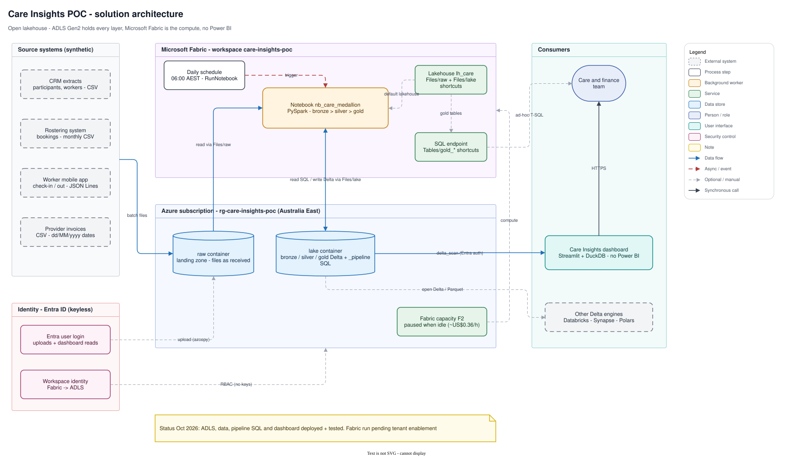
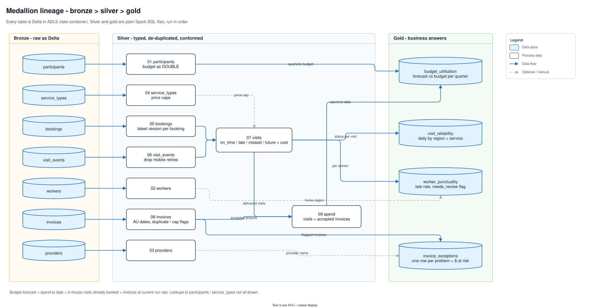
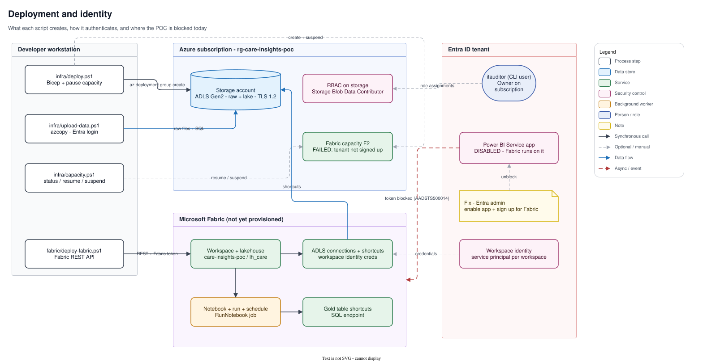
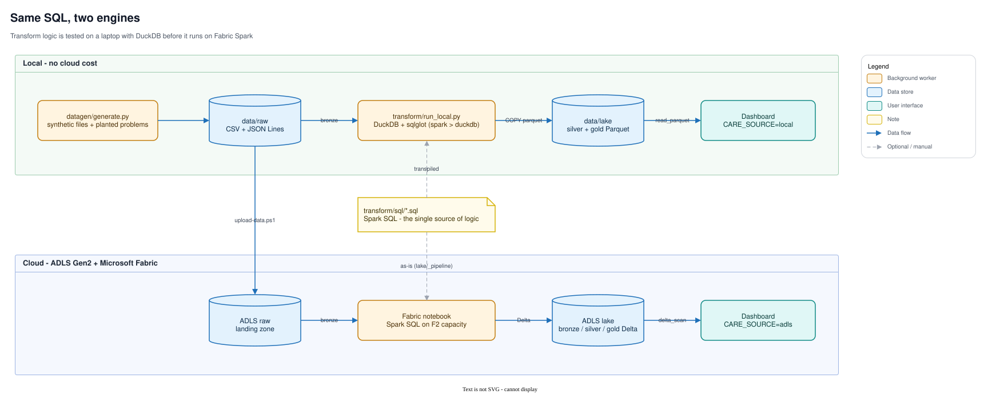

# Care Insights POC — Microsoft Fabric + Azure Data Lake

**Problem.** Under Support at Home, each participant has a quarterly budget. Money left unspent above the
carry-over limit is lost to the participant, overspend has to be absorbed or clawed back, and both are usually
found too late: after the quarter closes. The same data also hides missed and late visits and invoice errors from
third-party providers.

**This POC** joins rostering, the worker mobile app and provider invoices into a lakehouse, then answers four
questions every day:

| Question | Gold table | Example output (synthetic data) |
|---|---|---|
| Who will **under-use** or **overspend** their budget this quarter? | `gold_budget_utilisation` | 76 participants under-used, ~$311k at risk of being lost; 122 forecast over budget |
| Are visits happening, and on time? | `gold_visit_reliability` | 87.5% on time last 30 days, 218 missed |
| Which workers (or rosters) are consistently late? | `gold_worker_punctuality` | finds all 4 planted chronically-late workers |
| Which provider invoices should not be paid as-is? | `gold_invoice_exceptions` | 52 duplicates, 124 above price cap (top offender PRV004), 6 unknown participants |

The forecast isn't a straight-line projection. It's spend to date + **in-house visits already booked** for the
rest of the quarter + provider invoices at their current run rate.

> All data is synthetic (`datagen/generate.py`): fictitious IDs, no personal information. Budget amounts,
> price caps and the carry-over rule (greater of $1,000 or 10%) are illustrative. Confirm them against current
> program rules before using this for real decisions.

## Architecture: an open lakehouse

```
 Source systems                ADLS Gen2  (stcarepoc…, Australia East)         Consumers
 ──────────────                ─────────────────────────────────────────        ─────────
 CRM extracts (CSV) ─┐         raw/   landing zone, files as received
 Rostering (CSV)     ├──────►    reference/ scheduling/ mobile/ finance/
 Mobile app (JSONL)  │                     │  OneLake shortcut Files/raw
 Provider invoices ──┘                     ▼
 (CSV, AU dates)               ┌─────────────────────────────────────┐
                               │ Microsoft Fabric (F2 capacity)       │
                               │  Lakehouse lh_care                   │
                               │  Notebook nb_care_medallion (Spark)  │
                               │   bronze → silver → gold (Spark SQL) │
                               └─────────────────────────────────────┘
                                           │  OneLake shortcut Files/lake (read/write)
                                           ▼
                               lake/  Delta tables  bronze/ silver/ gold/   ──► Streamlit + DuckDB dashboard
                                      _pipeline/sql  (the transform code)   ──► Fabric SQL endpoint (gold_* table shortcuts)
                                                                            ──► any Delta reader (Databricks, Synapse, DuckDB, Polars…)
```

Design choices:

- **ADLS Gen2 is the system of record; Fabric is only the compute.** Every layer is open Delta/Parquet in
  your storage account, reached from Fabric through OneLake shortcuts. You can pause or remove Fabric without
  losing data, and other engines can read the same tables.
- **Transform logic is plain Spark SQL files** (`transform/sql`). The Fabric notebook runs them on Spark.
  `transform/run_local.py` runs the *same files* on DuckDB (transpiled with sqlglot), so logic gets tested on a
  laptop in seconds, with no cloud cost, before it ships.
- **No Power BI.** The dashboard is a code-first Streamlit app that queries gold Delta tables directly with
  DuckDB. Auth uses your Entra login, with no keys or gateways. It runs locally or in any container host
  (Azure Container Apps, App Service).
- **Keyless by default.** Fabric reaches ADLS with its *workspace identity* (RBAC: Storage Blob Data
  Contributor). The user uploads and the dashboard read with Entra login. Account keys exist only as a fallback
  (`-AuthMode Key`).
- **Data stays onshore**: Australia East for both storage and capacity.

## Diagrams

Editable `.drawio.svg` files: they show as pictures on GitHub and open for editing in draw.io or the
VS Code draw.io extension. The source is `docs/diagrams/care-insights.yaml` (a drawgen spec). Rebuild with
`drawgen build docs/diagrams/care-insights.yaml -o docs/assets/care-insights.drawio` then
`drawgen export docs/assets/care-insights.drawio -f svg`.









## Showcase site

<https://care-insights-demo.pages.dev> (Cloudflare Pages project `care-insights-demo`), built from `site/`:
a one-page write-up with an interactive demo drawn from the gold tables, the isometric scenes and the diagrams.
This repo and the site are public, so keep subscription, tenant and storage-account identifiers out of both
(the real values live only in the gitignored `.poc-state.json`).

```bash
python tools/scenes/care_scenes.py site/assets/iso          # isometric scenes (isoscene, C:\code\isoscene)
.venv/Scripts/python build/export_site_data.py              # gold tables -> site/assets/data/gold.json
cp docs/assets/care-insights* site/assets/diagrams/         # after rebuilding the diagrams (see above)
wrangler pages deploy site --project-name care-insights-demo --branch main
```

## Repository

| Path | What it is |
|---|---|
| `infra/main.bicep` | Storage account (HNS on, TLS 1.2, no public blob access), `raw` + `lake` containers, RBAC, Fabric capacity |
| `infra/deploy.ps1` | Deploys the Bicep and pauses the capacity straight away. `-SkipCapacity` while Fabric is not enabled |
| `infra/capacity.ps1` | `status` / `resume` / `suspend` the capacity |
| `infra/upload-data.ps1` | Uploads `data/raw` → `raw/` and the SQL → `lake/_pipeline/` |
| `datagen/generate.py` | Synthetic source-system files with planted problems (ground truth printed) |
| `transform/sql/{silver,gold}/*.sql` | The medallion logic (Spark SQL) |
| `transform/bronze_sources.json` | Which raw paths load into which bronze table |
| `transform/run_local.py` | Local DuckDB run of the same SQL → `data/lake/**.parquet` |
| `fabric/nb_care_medallion.py` | Fabric notebook (Git source format) |
| `fabric/deploy-fabric.ps1` | Fabric REST API: workspace, lakehouse, connections, shortcuts, notebook, run, table shortcuts, schedule |
| `app/dashboard.py` | Streamlit dashboard (Budgets · Visits · Workers · Invoices) |

## Run it

```powershell
# 0. one-off
python -m venv .venv; .\.venv\Scripts\pip install -r requirements.txt

# 1. local, no cloud
.\.venv\Scripts\python datagen\generate.py
.\.venv\Scripts\python transform\run_local.py
.\.venv\Scripts\streamlit run app\dashboard.py            # http://localhost:8501

# 2. Azure (uses your current az subscription; resource group rg-care-insights-poc)
.\infra\deploy.ps1                 # add -SkipCapacity until the tenant has Fabric
.\infra\upload-data.ps1

# 3. Fabric (once the tenant is enabled, see below)
.\infra\deploy.ps1                 # now creates the F2 capacity (paused)
.\fabric\deploy-fabric.ps1 -Schedule
.\infra\capacity.ps1 suspend       # when finished, stop paying for compute

# 4. dashboard on the cloud data
$env:CARE_SOURCE='adls'; .\.venv\Scripts\streamlit run app\dashboard.py
```

## Status: what's deployed, what's blocked

| Piece | Status |
|---|---|
| Resource group `rg-care-insights-poc`, ADLS Gen2 `stcarepoc…` (Australia East) | ✅ deployed |
| Synthetic data in `raw/` (124 files), pipeline SQL in `lake/_pipeline/` | ✅ uploaded |
| Pipeline logic (all 13 SQL steps) + dashboard | ✅ tested locally on DuckDB; DuckDB → ADLS Entra auth verified |
| Fabric capacity, workspace, notebook run | ⛔ **blocked by tenant config**, scripts ready but not yet run |

**The blocker.** The test tenant has never been signed up for Fabric, and its **"Power BI
Service" enterprise application is disabled** (`accountEnabled = false`). Fabric runs on that app, so Azure
refuses to create a capacity ("Tenant … wasn't recognized by Microsoft Fabric") and no token can be issued for
the Fabric API. This applies even though the POC uses no Power BI reports.

To unblock (needs an Entra **Application Administrator or Global Administrator**; the current account only has
Global Reader / Security Administrator):

1. Entra admin center → Enterprise applications → *Power BI Service* (`00000009-0000-0000-c000-000000000000`)
   → Properties → **Enabled for users to sign in: Yes**. Check first why it was disabled; it may be deliberate
   hardening.
2. Sign in once at <https://app.fabric.microsoft.com> to provision the tenant. A Fabric admin can then limit
   *who* can create workspaces (Admin portal → Tenant settings) so it stays locked down.
3. Run step 3 above.

Alternative if the tenant must stay locked: use Fabric in another tenant (e.g. a trial capacity) and point the
ADLS shortcuts at this storage account with `-AuthMode Key`. Cross-tenant workspace identity isn't supported.

## Cost

| Item | Cost (approx.) |
|---|---|
| ADLS Gen2, ~15 MB | cents per month |
| Fabric F2 capacity | ~US$0.36/hour **only while running** (~US$263/month if left on). Paused by default |
| Dashboard | free locally; ~US$10–20/month on Azure Container Apps if hosted |

## Next steps after the POC

- Swap synthetic files for real extracts (same folder contract), landed by Data Factory, Event Hubs/Eventstream
  for the mobile app, or SFTP → `raw/`.
- Incremental loads (Delta `MERGE` on `booking_id`, `event_id`, invoice key) instead of full overwrite.
- Data-quality expectations as a gold table (row counts, rejected rows) surfaced in the dashboard.
- Purview scanning of the storage account for lineage and classification once real personal data lands.
- Host the dashboard on Azure Container Apps behind Entra ID (Easy Auth).
